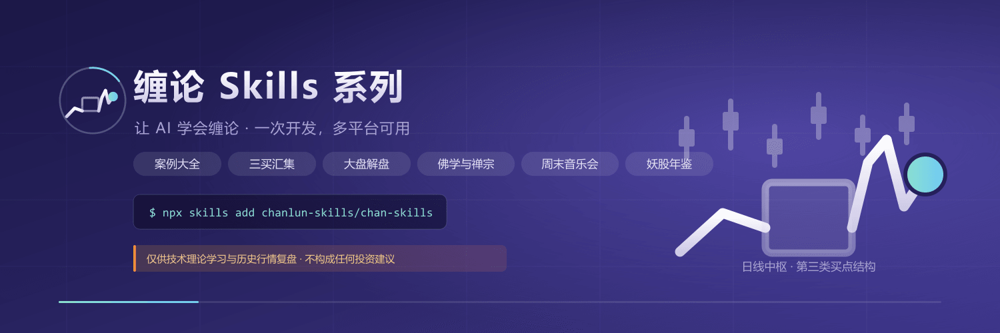
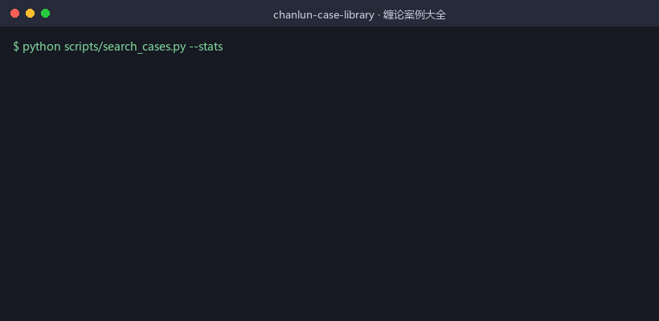
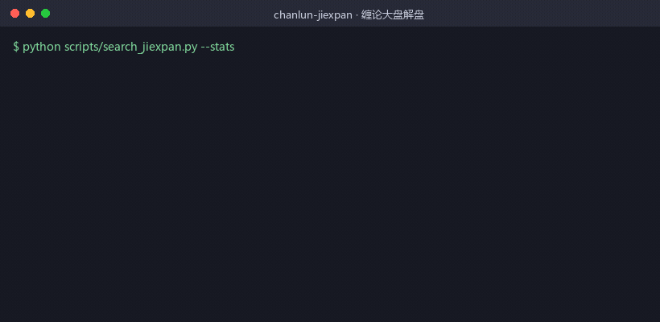
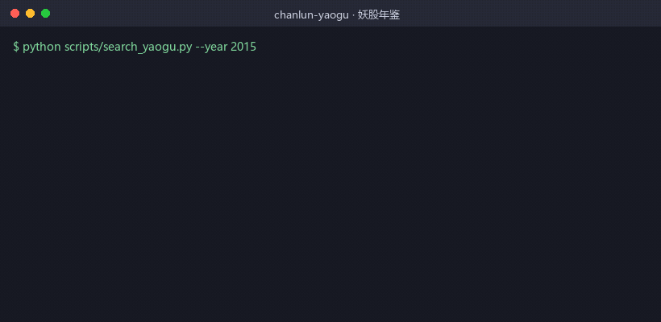
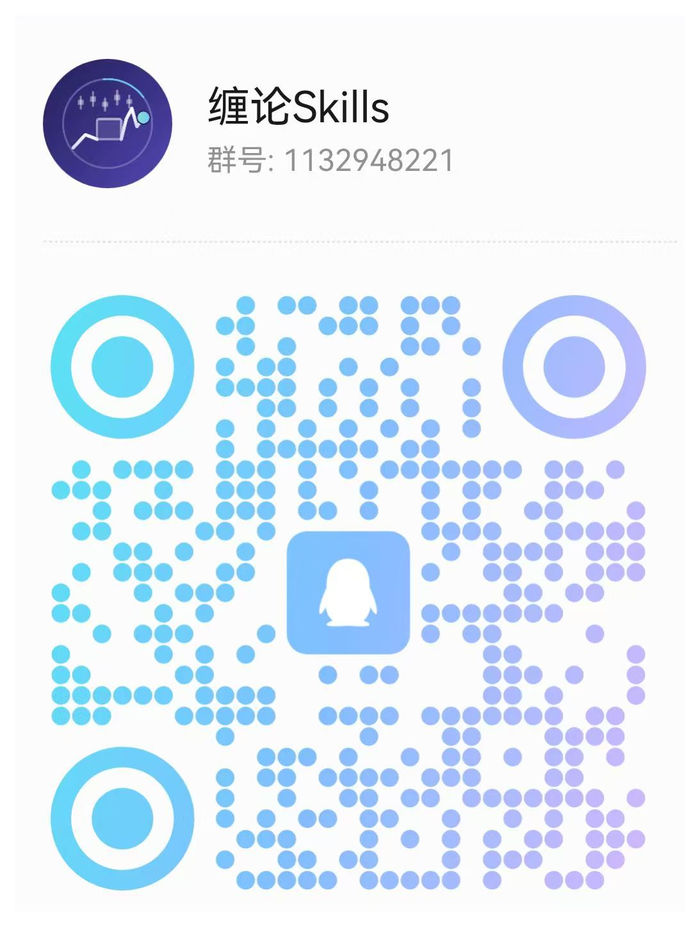

<div align="center">

# 缠论 Skills 系列

**让 AI 学会缠论：案例复盘 · 三买汇集 · 大盘解盘 · 佛学与禅宗 · 周末音乐会 · 妖股年鉴**



[](./)
[](./LICENSE)
[](./)
[](./CONTRIBUTING.md)

Agent Skills（SKILL.md 开放标准）· 一次开发，Claude Code / Codex / Cursor / WorkBuddy 等多平台可用

</div>

<div align="center">

**[GitHub 主仓库](https://github.com/chanlun-skills/chan-skills)** · [Gitee 镜像](https://gitee.com/chanlun-skills/chan-skills) · 国内访问建议走 Gitee

</div>

---

## 🌐 在线浏览

**https://chanlun-skills.github.io/chan-skills/**

网页版包含项目介绍、六个 Skill 详解、安装命令、真实运行演示、可直接扫码的加群入口。
内容随仓库 `main` 分支自动更新（GitHub Actions 部署）。

| 页面 | 地址 |
|---|---|
| 首页 | [chanlun-skills.github.io/chan-skills/](https://chanlun-skills.github.io/chan-skills/) |
| 加群页 | […/join.html](https://chanlun-skills.github.io/chan-skills/join.html) |
| 免责声明 | […/disclaimer.html](https://chanlun-skills.github.io/chan-skills/disclaimer.html) |

---

## 这是什么

把缠中说禅（缠师）的技术分析教学、佛学禅宗专栏、周末音乐连载，以及 37 年 A 股妖股实算数据，整理成 **6 个可被 AI 直接调用的 Skill**。

每个 Skill 都是一个标准目录，里面是：

- `SKILL.md` —— 技能说明与触发场景（AI 靠它决定何时调用）
- `references/` —— 结构化语料、索引、离线查阅器
- `scripts/` —— 零依赖命令行检索工具（`python scripts/xxx.py --stats` 即可验证）

**不是荐股工具。** 所有内容定位为技术理论学习与历史行情复盘，AI 遇到"现在该买什么"会明确拒绝。

---

## 📦 Skills 一览

| Skill | 目录 | 内容 | 体量 |
|---|---|---|---|
| 缠论案例大全 | [`chanlun-case-library`](./chanlun-case-library) | 3,026 条历史案例、347 只个股、六大经典案例深度剖析 | 3.3MB |
| 缠论三买汇集 | [`chanlun-sanmai`](./chanlun-sanmai) | 20 条日线三买案例（确认13/否认3/讨论4）、81 条原话库、五步判定链、三处流传资料纠错 | 1.3MB |
| 缠论大盘解盘 | [`chanlun-jiexpan`](./chanlun-jiexpan) | 515 篇时间线解盘、946 条大盘主题帖、6 个关键时段复盘、约 1,100 条文库目录 | 12MB |
| 缠论佛学与禅宗 | [`chanlun-chan-zen`](./chanlun-chan-zen) | 7,131 条语料约 134 万字、12 大争鸣议题、2,355 条概念索引、离线检索站点 | 18MB |
| 缠师周末音乐会 | [`chanlun-music`](./chanlun-music) | 42 期古典音乐连载全文、7,149 条回复、77 篇声乐/作曲/流行专题、离线查看器 | 5.3MB |
| 妖股年鉴 | [`chanlun-yaogu`](./chanlun-yaogu) | 1990—2026 共 37 年 444 条妖股明细、日线谷→峰实算、420 组日线、40 条修正榜 | 6.5MB |

> 合计 158 个文件、约 46MB，全部离线可用，无任何运行时依赖。

---

## ✨ 效果演示

以下动图均为**真实运行**各 Skill 附带的零依赖检索脚本所得，非示意图。

<table>
<tr>
<td width="50%" align="center"><b>① 缠论案例大全</b><br><sub>关键词检索 · 347 只个股 / 3,026 条案例</sub></td>
<td width="50%" align="center"><b>② 缠论三买汇集</b><br><sub>原话库 · 20 案例 / 81 条原话</sub></td>
</tr>
<tr>
<td align="center"></td>
<td align="center"></td>
</tr>
<tr>
<td align="center"><b>③ 缠论大盘解盘</b><br><sub>515 篇时间线解盘 / 946 条主题帖</sub></td>
<td align="center"><b>④ 缠论佛学与禅宗</b><br><sub>7,131 条语料 / 约 134 万字</sub></td>
</tr>
<tr>
<td align="center"></td>
<td align="center"></td>
</tr>
<tr>
<td align="center"><b>⑤ 缠师周末音乐会</b><br><sub>42 期全文 / 7,149 条回复</sub></td>
<td align="center"><b>⑥ 妖股年鉴</b><br><sub>37 年 444 条 / 日线谷→峰实算</sub></td>
</tr>
<tr>
<td align="center"></td>
<td align="center"></td>
</tr>
</table>

**每条命令都可以自己在本地复现** —— 装完 Skill 后进入对应目录执行即可，脚本只用 Python 标准库：

```bash
cd chanlun-case-library && python scripts/search_cases.py --stats
cd chanlun-yaogu       && python scripts/search_yaogu.py --year 2015
```

> 想看更复杂的用法（多条件检索、指定年份、主题分布、K 线复算），可以在 [Issues](https://github.com/chanlun-skills/chan-skills/issues) 里提需求，我来补演示。

---

## 🚀 安装方式

### 方式一：一键安装（推荐）

```bash
# 安装全部 6 个 Skill
npx skills add chanlun-skills/chan-skills

# 只安装某一个
npx skills add chanlun-skills/chan-skills --skill chanlun-sanmai
```

> **⚠️ clone 失败怎么办（国内网络常见）**
>
> `npx skills add` 底层是 `git clone https://github.com/...`。部分国内网络/代理会拦截 GitHub 的 HTTPS 连接，
> 报 `curl 7 CONNECT tunnel failed, response 502` 或 `RPC failed; expected 'packfile'`。
> **解决办法：改用 Gitee 镜像**（内容与主仓实时同步，每 5 分钟自动同步一次）：
>
> ```bash
> npx skills add https://gitee.com/chanlun-skills/chan-skills.git
>
> # 或手动克隆后本地安装
> git clone https://gitee.com/chanlun-skills/chan-skills.git
> cd chan-skills && cp -r chanlun-* ~/.claude/skills/
> ```

### 方式二：手动克隆

```bash
git clone https://github.com/chanlun-skills/chan-skills.git
cd chan-skills

# Claude Code 全局安装
cp -r chanlun-* ~/.claude/skills/

# 或项目级安装
cp -r chanlun-* ./.claude/skills/
```

> 国内网络建议克隆 Gitee 镜像：`git clone https://gitee.com/chanlun-skills/chan-skills.git`

### 方式三：各平台市场

| 平台 | 位置 | 收录状态 |
|---|---|---|
| SkillsMP | skillsmp.com | ⏳ 待收录（自动索引 GitHub，需仓库有 star） |
| skills.sh | `npx skills add` 官方目录 | ⏳ 待收录（需有人执行过 `skills add` 上报遥测） |
| 腾讯 SkillHub | skillhub.cn | ⏳ 待发布（需 GitHub 授权后主动发布） |
| ClawHub | clawhub.ai | ⏳ 待发布（需 `clawhub skill publish`） |

> **目前最可靠的安装方式就是上面的方式一 / 方式二**（Gitee 镜像路径国内可用）。

### 安装后验证

```bash
cd chan-skills/chanlun-case-library
python scripts/search_cases.py --stats
```

有任何输出即安装成功。所有脚本仅用 Python 标准库，**无需 pip install**。

---

## 💬 加入交流

**扫码进群** —— 👉 [**点此打开加群页**](./docs/join.html)

<table>
<tr>
<td align="center"><b>QQ 群（永久有效 · 推荐）</b><br>
QQ 群</b><br><br><small>群号 1132948221</small>'"></td>
<td align="center"><b>企业微信群（永久有效）</b><br>
企业微信群</b><br><br><small>见加群页</small>'"></td>
</tr>
<tr>
<td align="center">群号 <code>1132948221</code></td>
<td align="center">「缠论AI时代」· 永久活码</td>
</tr>
</table>

> **扫不出？直接用群号 <code>1132948221</code>** —— 在 QQ 里搜索群号或"添加群"即可，不用扫码。
> QQ 群二维码是彩色点阵格式，个别手机相机可能识别不了，群号是永远有效的兜底。

两个入口都是**永久有效**：QQ 群二维码本身不过期；企业微信群用的是「加入群聊」活码，群满 200 人会自动建新群，码不会失效。

加群页 `docs/join.html` 是一个**永久地址**，README 只放这一个链接，群有变化时页面内容跟着仓库更新，链接永远不用改。

Discussions 开放 Q&A 与案例讨论，欢迎把你的复盘结果发上来。

---

## ☕ 请作者喝杯茶

<table>
<tr>
<td align="center">微信收款码</b><br><br><small>待上传<br>docs/images/donate-wechat.png</small>'"></td>
<td align="center">支付宝收款码</b><br><br><small>待上传<br>docs/images/donate-alipay.png</small>'"></td>
<td align="center"><b>爱发电</b><br><a href="https://afdian.com/a/待填">afdian.com/a/待填</a></td>
</tr>
<tr>
<td align="center">微信</td>
<td align="center">支付宝</td>
<td align="center">海外 / 不方便扫码</td>
</tr>
</table>

这些 Skill 是完全免费开源的。维护它们需要时间 —— 数据纠错、脚本维护、文档更新。如果对你有帮助，一杯咖啡就是最好的支持。

> 微信 / 支付宝扫码时备注里写个 **"缠论"** 或 **"咖啡"**，方便我认出来 ❤️

---

## 🧭 典型用法

| 你问 | 用哪个 Skill |
|---|---|
| "缠师当年怎么分析中国联通的？" | 案例大全 → 247 条案例时间线 |
| "这个位置算不算三买？五步怎么走？" | 三买汇集 → 判定链 + 确认/否认双案例 |
| "2007 年 5 月 30 日缠师怎么判断大盘的？" | 大盘解盘 → 530 当日三来源交叉印证 |
| "缠师说的'缘起'是什么意思，出处在哪？" | 佛学与禅宗 → 概念索引定位原文 |
| "第 5 期音乐会放的什么曲子？缠师怎么评的？" | 周末音乐会 → 42 期节目单与乐评 |
| "2015 年最猛的妖股是哪些，实算涨幅多少？" | 妖股年鉴 → 37 年年份卡 + 日线实算 |

跨 Skill 组合示例：
- **"2007 成都建投成妖的过程"** → 妖股年鉴给实算涨幅 → 案例大全给同期解盘原文
- **"做一份缠师人物全景介绍"** → 佛学库给禅学一面 → 音乐库给审美一面 → 其余三库给交易教学一面

---

## 📁 仓库结构

```
chan-skills/
├── README.md
├── LICENSE                       CC BY-NC-SA 4.0
├── .github/
│   ├── FUNDING.yml               打赏入口
│   ├── ISSUE_TEMPLATE/           问题反馈 + 内容纠错
│   └── workflows/
│       ├── pages.yml             GitHub Pages 自动部署
│       └── repo-meta.yml         Topics / 描述自动同步
├── docs/
│   ├── index.html                GitHub Pages 首页
│   ├── join.html                 加群页（永久链接）
│   ├── disclaimer.md             完整免责声明
│   ├── disclaimer.html           同上（脚本生成，供 Pages 渲染）
│   └── images/                   banner / 演示动图 / 二维码
├── scripts/
│   ├── make_demos.py             演示动图生成器
│   └── md2html.py                Markdown → HTML（Pages 用）
├── chanlun-case-library/         Skill 1 · 缠论案例大全
├── chanlun-sanmai/               Skill 2 · 缠论三买汇集
├── chanlun-jiexpan/              Skill 3 · 缠论大盘解盘
├── chanlun-chan-zen/             Skill 4 · 缠论佛学与禅宗
├── chanlun-music/                Skill 5 · 缠师周末音乐会
└── chanlun-yaogu/                Skill 6 · 妖股年鉴
```

> **网站版**：<https://chanlun-skills.github.io/chan-skills/> —— 由 `docs/` 目录经 GitHub Actions 自动发布，改完 `main` 分支即上线。
> `docs/disclaimer.html` 由 `python scripts/md2html.py` 从 `disclaimer.md` 生成，改完 md 请重新运行该脚本。

---

## ⚠️ 免责声明

本仓库所有内容仅为**缠论技术理论学习与历史行情复盘**，不构成任何投资建议、证券投资咨询或买卖推荐。

- 缠师原文时间窗口为 2002—2008 年，与当下市场制度环境存在根本差异，**历史结构不可直接映射到当前市场**
- 妖股年鉴采用"日线谷→峰最大涨幅"口径，与其他口径不可直接比较
- 音乐会的缠师回复正文在源存档中缺失，引用以 42 期原文为准

**完整版声明见 [docs/disclaimer.md](./docs/disclaimer.md)。**

市场有风险，决策需独立判断，风险自担。

---

## 📜 License

| 内容 | 协议 |
|---|---|
| 数据整理、结构化摘要、检索脚本、文档 | [CC BY-NC-SA 4.0](./LICENSE) |
| 缠中说禅（缠师）原始文本 | 版权归原权利人所有，本仓库仅作索引与学习研究用途 |
| 音频、录音、影像 | 不收录 |

---

## 📮 参与贡献

- **纠错**：缠论案例的结构划分、股票代码、年份、涨幅口径有错漏 → 提 Issue，用「内容纠错」模板
- **补图**：录一段你使用 Skill 的演示动图 → PR 或 Issue
- **提需求**：想要哪个主题的 Skill，告诉我们

详细贡献指南见 [CONTRIBUTING.md](./CONTRIBUTING.md)。

---

## 📝 更新日志

| 日期 | 更新内容 |
|---|---|
| 2026-11 | 首次发布 6 个 Skill |

> 每次大更新在这里加一行即可；正式版本也可以同时发一个 GitHub Release（仓库右侧 Releases → Draft a new release）。

---

## 👤 关于作者 · 更多内容

**缠论量化** —— 缠论内容整理者，长期做缠论体系的结构化与数据化（案例 / 解盘 / 佛学 / 音乐 / 妖股数据）。

<table>
<tr>
<td align="center" width="50%">
<b>公众号「缠论量化」</b><br>
公众号</b><br><br><small>缠论量化</small>'">
</td>
<td align="center" width="50%">
<b>其他入口</b><br><br>
<b>知乎</b>：缠论量化<br>
<a href="https://www.zhihu.com/people/chanlunquant">zhihu.com/people/chanlunquant</a><br><br>
<b>缠论资料大全</b>（夸克网盘 · 免费分享）<br>
<a href="https://pan.quark.cn/s/f766d88b7331">pan.quark.cn/s/f766d88b7331</a>
</td>
</tr>
</table>

> 想跟进公众号的缠论文章，或需要整理好的原始资料包，从上面任一入口进来即可。
